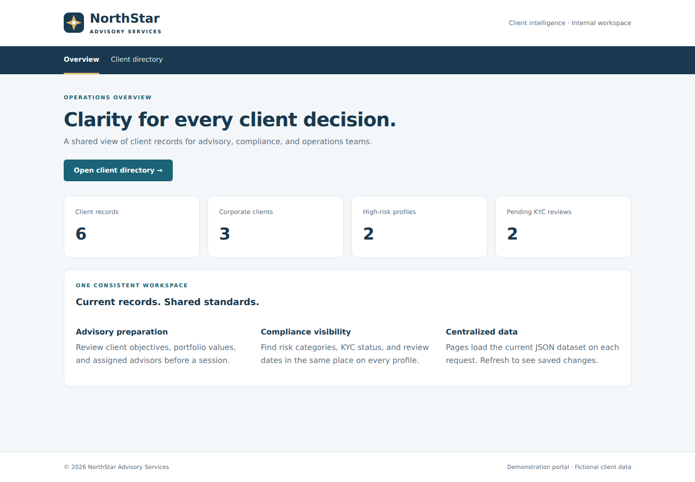
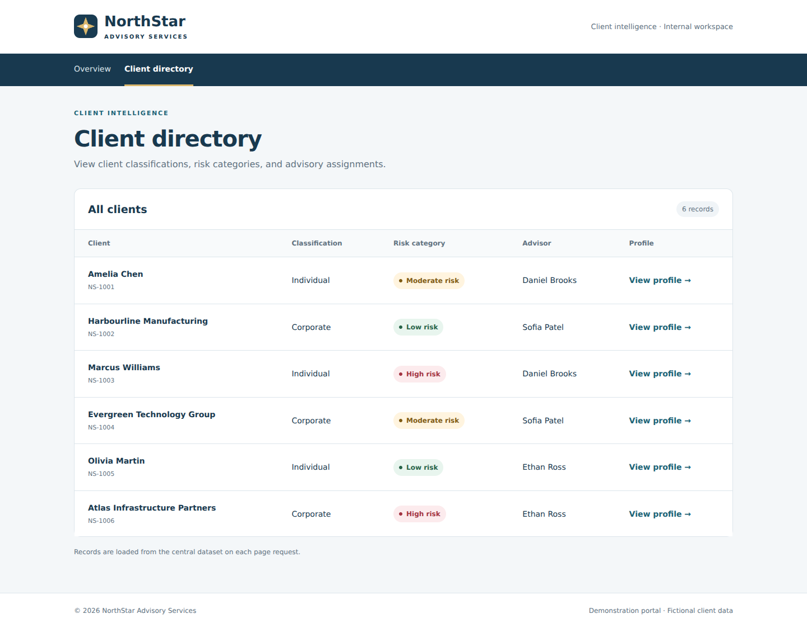
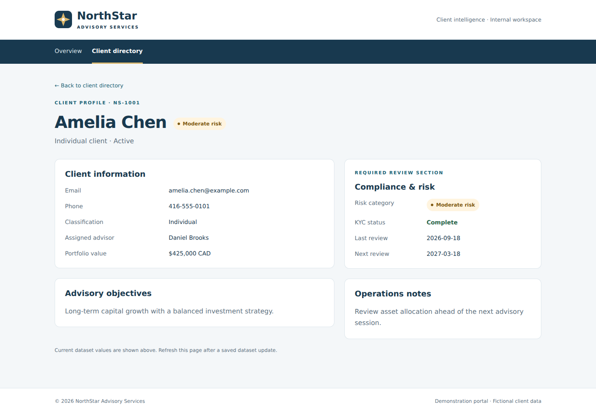
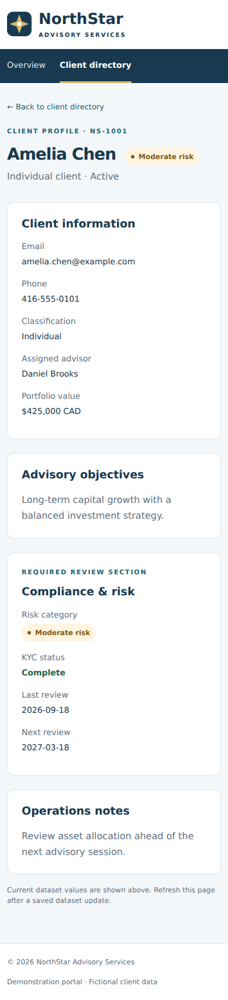

# NorthStar Advisory Services — Client Portal

A server-rendered Express application that replaces independent static pages with a shared EJS layout and reusable components. Advisors, compliance analysts, and operations teams can browse fictional client records and open individual profiles with consistent presentation.

## Installation

Requirements: Node.js 20 or newer and npm.

```bash
cd northstar-advisory
npm ci
```

## Startup

```bash
npm start
```

Open **http://localhost:3000**. Set `PORT` to use another port. For development:

```bash
npm run dev
```

## Implemented routes

| Method | Route | Description |
| --- | --- | --- |
| GET | `/` | Overview with current dataset metrics |
| GET | `/clients` | Dynamically generated client directory |
| GET | `/clients/:id` | Individual client profile, advisory objectives, compliance details and operations notes |
| GET | `/css/bootstrap.min.css` | Locally served Bootstrap framework |
| GET | `/css/styles.css` | Shared organizational styling |
| GET | `/images/northstar.svg` | Original NorthStar logo asset |

Unknown clients and pages return a 404 using the same layout. Missing, malformed or invalid datasets return a controlled 500 page.

## Architecture and lab tasks

- **Application setup:** `app.js` configures Express, EJS, Express EJS Layouts, static files, routes and error handling.
- **Layout and partials:** all pages use `views/layouts/main.ejs`. Header, navigation and footer are included once by the layout. The risk badge partial is shared by the list and detail pages.
- **Dynamic rendering:** route handlers call controller methods, which read and validate `data/clients.json` asynchronously on each request. EJS iterates through clients and inserts record values using escaped output.
- **Styling:** Bootstrap is installed as an npm dependency and served locally; custom CSS adds the shared palette, typography, navigation, cards and risk badges. No CDN or network connection is needed for styling after installation.

## Central dataset updates

Edit and save `data/clients.json`, then refresh any page. The next request reads the latest saved file without restarting the server or editing templates. The list, overview counts and profiles use the same source.

The application deliberately avoids `require('./data/clients.json')` for operational reads because that would cache the dataset. HTML responses use `Cache-Control: no-store`.

Updates are visible on the **next page request or refresh**, not pushed into already-open pages. WebSockets, automatic polling and a database are outside this lab. For reliable concurrent updates, write a new file and atomically replace the dataset rather than editing a file while it is being read.

### Record schema

Each record contains:

- Unique URL-safe `id`; `name`; `classification` (`Individual` or `Corporate`)
- `riskCategory` (`Low`, `Moderate`, `High`), shown as a text-and-color badge
- `email`, `phone`, `advisor`, `status`
- Nonnegative numeric `portfolioValue` (CAD)
- `lastReview`, `nextReview` (ISO date strings)
- Boolean `kycComplete`
- `objective` and `notes`

All supplied records and contacts are fictional. The dataset is a teaching example. Authentication, role permissions, audit history and production financial-system controls are not implemented.

## Project structure

```text
northstar-advisory/
├── app.js
├── package.json
├── package-lock.json
├── README.md
├── routes/
│   └── clientRoutes.js
├── controllers/
│   └── clientController.js
├── data/
│   └── clients.json
├── views/
│   ├── layouts/
│   │   └── main.ejs
│   ├── partials/
│   │   ├── header.ejs
│   │   ├── navigation.ejs
│   │   ├── footer.ejs
│   │   └── riskBadge.ejs
│   └── pages/
│       ├── home.ejs
│       ├── clients.ejs
│       ├── clientDetails.ejs
│       └── error.ejs
├── public/
│   ├── css/
│   │   └── styles.css
│   └── images/
│       └── northstar.svg
├── tests/
│   └── portal.test.js
└── docs/
    └── screenshots/
```

## Screenshots

### Shared layout usage — overview

The header, navigation and footer come from the shared layout, which wraps each page body.



### Dynamic client list



### Client details



### Mobile client details



## Tests

```bash
npm test
```

Integration tests verify the three page routes, shared layout, profile links, risk labels, static assets, 404 handling, empty lists, escaped dataset content and live dataset rereads. Dataset update tests use a temporary file and do not modify the supplied records.
